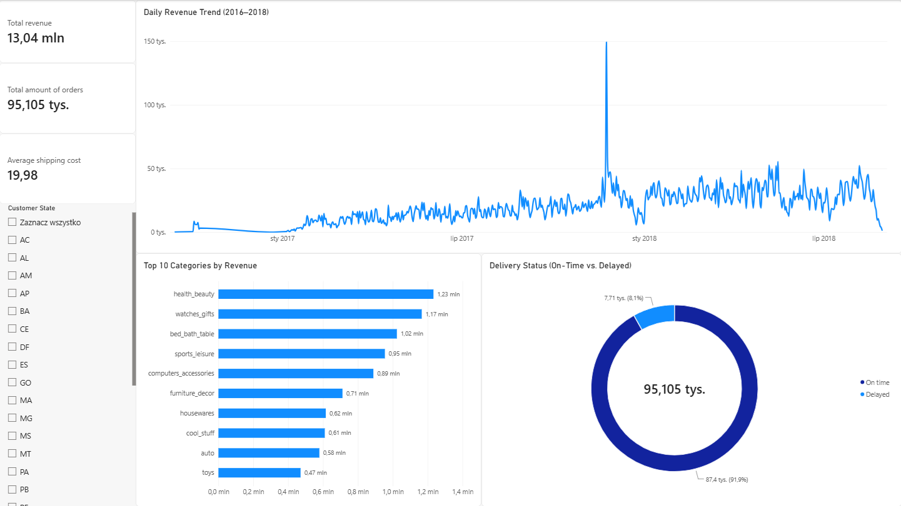

# Olist E-Commerce Sales & Logistics Analysis

In this project I analyzed real e-commerce data from the Brazilian marketplace Olist (orders from 2016 to 2018). My goal was to practice the whole data analysis process from start to finish: cleaning raw CSV files in Python, working with a relational database in SQL, and creating a dashboard in Power BI.

## Tools used
- Python (pandas, sqlite3)
- SQL (SQLite in VS Code)
- Power BI

## How I did it

First, I wrote a script in Python (cleaning_data.py) to load 5 raw CSV files from Kaggle (orders, order_items, products, customers, and category_translation). I filtered the orders to keep only delivered ones and removed rows with missing values. I also merged the products table with the translation table to get English category names, and saved everything into a local SQLite database (olist_ecommerce.db).

Next, in SQL (SQL/analysis.sql), I wrote a few basic queries using JOIN, GROUP BY, and CASE WHEN to check the top product categories, states with the most orders, and delayed deliveries. Then I created a SQL view called dashboard_data that combines all 4 tables into one, and used a short Python script (export_to_csv.py) to export that view to a CSV file.

Finally, I imported the cleaned CSV into Power BI (powerbi_dashboard/olist_dashboard.pbix) and built a one-page dashboard showing revenue, total orders, shipping costs, top categories, daily sales, and delivery status.

## Dashboard preview

## Main findings
- Delivered orders generated 13.04M BRL in total revenue across 95,105 unique orders, with an average shipping cost of 19.98 BRL.
- The top 3 categories by revenue were health_beauty (1.23M BRL), watches_gifts (1.17M BRL), and bed_bath_table (1.02M BRL).
- Daily sales had a massive spike on November 24, 2017 (Black Friday), reaching almost 150k BRL in one day compared to the usual 20k-40k BRL.
- 91.9% of orders (87.4k) were delivered on time, while 8.1% (7.71k) arrived after the estimated delivery date.

## Note on data
The raw CSV files and the SQLite database (43.3 MB) are not included in this repository because of GitHub's file size limits. You can download the original dataset from Kaggle (Brazilian E-Commerce Public Dataset by Olist), put the files into a raw_data folder, and run cleaning_data.py to recreate the database.
